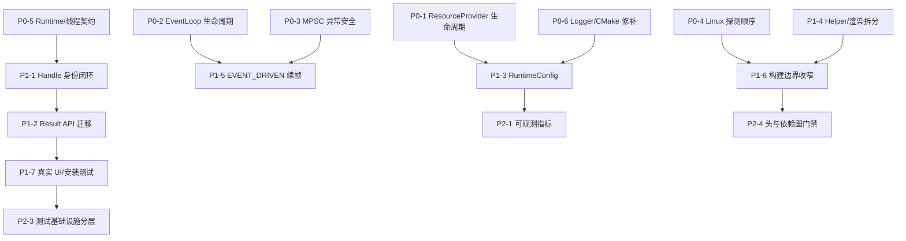

# VMP-ui 独立架构与实现审查（锐评）

- **日期**：2026-09-13
- **输入来源**：仅当前工作区 `d:\code\VMP-ui` 中的现有源码、公共头、示例、测试、工具脚本与 CMake 配置
- **明确排除**：未读取、引用或依赖任何历史记忆文件、session memory、repo memory；未把既往会话结论当作事实
- **重点范围**：`src/`、`include/`、`example/`、`tests/`、`tools/`、根及子目录 `CMakeLists.txt`
- **审查方式**：静态阅读关键入口、所有权链、帧链、事件链、渲染资源链、测试拓扑和边界门禁；辅以当前编辑器诊断。未执行构建或测试，因此“已有测试”不等于“本次已验证通过”
- **改动类型判断**：当前不是推倒重来的架构重构需求。推荐先做 **P0 生命周期与契约修补**，再做 **P1 接口/边界收敛**，最后做 **P2 构建与可观测性工程化**

---

## 1. 执行摘要

### 1.1 总评

这不是一个“毫无架构”的 UI 库。相反，项目已经认真处理了不少 C++ UI 最容易翻车的区域：Runtime 隔离、GPU 资源代际、逆序关闭、事件阶段、脏渲染、公共头去第三方依赖、安装包消费、SDL 全局测试隔离等。尤其 `GpuDeviceGeneration`、`ApplicationLifecycle`、`FrameTick` 和两类门禁脚本，说明实现者已经从“功能能跑”转向“契约可守”。

但目前最大问题也很明确：**局部机制很精细，顶层契约仍不统一**。公共 API 一半使用 `Result<T>`，另一半返回裸 `entity`/`void` 并静默失败；Runtime 名义上依赖注入，公共 API 实际仍依赖 TLS 当前上下文；实体句柄名义上带身份信息，`EntityHandle` 却直接丢弃 token；资源 Provider 名义上按 Runtime 注入 Logger，默认实现却做成捕获首个 Logger 的进程静态对象。结果是：单 Application、单线程、正常关闭路径较扎实，错误路径、重入、重复初始化和跨平台构建仍有结构性缺口。

### 1.2 风险分布

| 等级 | 数量 | 结论 |
|---|---:|---|
| **严重（Critical）** | 0 | 静态审查未发现必然导致所有正常运行失败的单点问题 |
| **高（High）** | 6 | 可能造成悬空访问、句柄失效后静默错改、生命周期竞态、配置特定平台失效，或公共契约不可可靠执行 |
| **中（Medium）** | 10 | 主要影响可维护性、错误诊断、测试真实性、扩展成本与长期边界稳定性 |
| **低（Low）** | 5 | 文档漂移、命名/重复配置、局部实现卫生问题 |

### 1.3 最核心的五条结论

1. **必须先修默认资源 Provider 的静态 Logger 悬空风险**：`GetDefaultUiResourceProvider()` 将首次传入的 `Logger&` 固化到函数静态 Provider，后续 Runtime 会复用它。
2. **必须补齐 EventLoop 析构/并发使用契约**：底层析构仅 `Exit()`，不等待外部 `Exec()` 线程结束；上层析构也只可靠 join 帧调度线程，不拥有/等待执行 `exec()` 的线程。
3. **公共实体身份模型尚未完成**：`EntityHandle` 不含 token，`MakeEntityHandle()` 明确忽略 token；`WindowHandle` 虽含 token，但当前 API 没有统一验证路径。
4. **`Result<T>` 只覆盖少数 API，无法形成统一错误语义**：大量创建和修改 API 静默返回 `null_entity` 或 `void`，让资源失败、无效实体和错误 Runtime 难以观测。
5. **测试数量可观，但端到端真实性不足**：截图回归只画 SDL 原语，不经过 VMP-ui 的 Factory/Layout/RenderSystem；安装消费者存在，却未进入顶层测试拓扑。

### 1.4 已确认的 Runtime 与日志方向

本次讨论确认以下方向，后续实现应以此为准：

1. **公共 API 不再使用 `UiRuntime::current()`，也不接受 `UiRuntime&`**。公共 API 只能面向 `Application`、句柄和公共数据类型；Application 内部绑定唯一的 Runtime。
2. **System 层显式注入内部依赖**。`Registry`、`Dispatcher`、`Logger`、资源 Provider 和配置由 `UiRuntime`/`SystemManager` 注入 System；Manager/Renderer 沿用显式引用或指针传递。
3. **内部日志只在 System/Runtime 边界决策和输出**。底层 Manager、Provider、队列和纯算法模块返回 `Result`/状态/统计，不直接打印业务日志，避免重复日志和隐藏 Logger 生命周期。
4. **外部日志通道与内部日志通道完全分离**。`ui::log` 不应通过 `UiRuntime::current()` 取得内部 Logger；外部回调、外部调试输出和库内部 System 日志是两套独立责任链。
5. **提供外部可调用的库调试等级接口**。外部代码可以设置库的诊断等级；该设置不等同于外部应用自己的日志等级，也不要求外部日志必须写入 VMP-ui 内部文件。
6. **默认等级按编译配置决定**：Debug 编译默认输出全部库诊断信息；Release 编译默认不输出库诊断信息。运行时显式设置等级后，外部设置可以覆盖默认值。

7. **外部日志采用回调接入，本阶段不再修改源码**。保留现有 `ui::log::SetCallback(Callback)` 作为外部日志接入方向；外部应用负责实现回调、决定输出目的地，并可将消息转发到自己的日志系统。当前先固化设计契约和迁移要求，暂不继续扩展 `Log.cpp`、`Logger.hpp` 或公共日志 API 的实现。

8. **任何公共接口都不得暴露 `UiRuntime`**。`UiRuntime` 是项目内部的运行时上下文，公共头、公共函数、公共类成员、公共回调和安装消费者接口均不得在参数、返回值、成员字段或模板约束中暴露 `UiRuntime`。

   - 外部调用者只面向 `Application`、实体句柄、窗口句柄和公共数据类型；
   - Runtime 的获取、注入和生命周期由 `Application` 内部负责；
   - System、Manager 和 Renderer 可以在内部使用 Runtime 注入，但该依赖不能穿透 `include/ui/**`；
   - 不允许为了消除 TLS 而把 `UiRuntime&` 直接加到公共 API；应提供不暴露 Runtime 的 Application/API facade 或由 Application 内部绑定上下文；
   - 不存在“多 Runtime”公共场景，因此不需要 Runtime 参数、Runtime 选择器或 Runtime 身份校验 API。

9. **不支持多 Runtime，`Application` 保持进程内单实例**。

   - `Runtime` 只是 `Application` 的一个内部组件，不是并列的公共概念；
   - 一个进程只应存在一个 `Application` 实例，全局 UI 状态、SDL 生命周期、`AppConfig`、事件循环和渲染设备都归属于该实例；
   - 公共 API 不需要、也不应该携带 Runtime 或 Application 身份参数；调用归属默认就是进程内唯一的那个 Application；
   - 重复创建 `Application` 应被视为契约违规，在 `Application` 构造层显式拒绝或明确失败，而不是“半支持”地让两套 Runtime 共存；
   - 因此 `EntityHandle`/`WindowHandle` 不再以“跨 Runtime 校验”为目标，其价值转为实体有效性、窗口归属和生命周期校验；
   - 测试如果需要多个隔离上下文，应使用内部 Runtime 而非公共 API 契约，并在测试内部自行管理生命周期。

10. **锚点系统必须实现完整 Qt Quick anchors 语义**。当前父节点边缘/居中/fill 子集只能作为过渡实现，不能作为最终交付。最终目标必须覆盖七条 anchor line、父节点与同层 sibling、margin 覆盖规则、`fill`/`centerIn`、baseline、implicit size、冲突与循环依赖、目标删除/重挂载、Flex 互斥和脏传播；当前实现中的 Yoga absolute 快捷映射和 `originalSize` 快照恢复不能作为最终架构。

这里的“全都不打印”是库诊断默认策略，不应吞掉不可恢复初始化失败、契约违规和调用方主动请求的错误结果。错误仍必须通过 `Result` 返回；是否记录由 Runtime/System 的诊断策略决定。

---

## 2. 做得好的地方

## 2.1 模块边界与依赖方向

1. **公共头已主动隔离第三方类型**。`include/ui/MathTypes.hpp` 等公共基础类型没有直接暴露 Eigen；`tools/check_public_headers_self_contained.py` 扫描 `include/ui/**` 与 `include/ui.hpp`，禁止 EnTT、SDL3、spdlog、Yoga、FreeType、HarfBuzz、cmrc 和内部路径。这比单纯“文档约定”可靠。
2. **构建期存在架构回归门禁**。根 `CMakeLists.txt` 将 `ui_architecture_boundary_check` 和 `ui_public_headers_self_contained_check` 设为 `ALL`，能阻止已知债务继续扩散。
3. **公共 API 与实现大体分离**。`include/ui/Application.hpp` 使用 PImpl；公开 `ui::entity` 是稳定整数类型，避免 EnTT 泄漏到消费者。
4. **渲染实现进行了合理 TU 拆分**。`RenderSystem` 被拆为 `RenderBackend.cpp`、`RenderResources.cpp`、`RenderFrame.cpp`，重量状态落在 `RenderSystemImpl.hpp`，方向正确，避免继续堆成单个超大 `.cpp`。
5. **系统只依赖 Runtime 提供的 Registry/Dispatcher/Logger**。`SystemManager::registerBuiltInSystems()` 显式将 `UiRuntime&` 传给各 System，`systems/` 中未继续扩散 `UiRuntime::current()`，这是真实的依赖收敛成果。

## 2.2 生命周期与所有权

1. **Application 的 SDL 关闭顺序被单独建模**。`src/core/ApplicationLifecycle.hpp` 的 `ApplicationLifecycle::Shutdown()` 明确“先系统、后 SDL”，支持幂等，并有 `test_ApplicationLifecycle.cpp` 覆盖构造失败和清理异常。
2. **GPU 设备代际模型设计扎实**。`src/common/GpuDeviceGeneration.hpp` 让资源 deleter 通过共享代际状态确认设备仍活动，避免旧资源误用新设备释放；`LateReleaseSkipped()` 使防御性跳过可观测。
3. **GPU RAII 工厂限制了错误所有权创建**。`wrappers::MakeGpuResource()` 要求代际句柄，不提供随意绑定裸设备的资源 owner，减少了资源与设备错配。
4. **RenderSystem 明确执行资源 DAG 逆序清理**。`RenderSystem::cleanup()` 先 renderer/batch，再 CommandBuffer/TextTextureCache/PipelineCache，再 Icon/Image/Font，最后 `DeviceManager::cleanup()`；并在关闭后检查 late release 计数。
5. **窗口 claim 策略考虑了多窗口安全**。`DeviceManager::claimWindow()` 在已有窗口绑定后，不再因为后续窗口 claim 失败而销毁全局设备，避免连带破坏已运行窗口。

## 2.3 线程与事件模型

1. **底层队列明确是有界 MPSC + 单消费者**。`src/utils/MpscQueue.hpp` 和 `src/utils/EventLoop.hpp` 的角色边界清晰，队列满返回失败而非无限增长。
2. **lost-wakeup 处理不是拍脑袋**。`utils::EventLoop::WaitForWork()` 使用 wake epoch + `atomic::wait`；`core::EventLoop` 的调度线程也使用 epoch + 条件变量谓词，设计有一致性。
3. **优雅退出考虑了正在 Post 的生产者**。`ProducerGuard` 与 `active_producers_` 让 `drain_remaining=true` 不会在生产者已进入 Post 时提前结束；`DrainWaitsForProducerAlreadyInsidePost` 对该竞态有针对性测试。
4. **生产帧链唯一化**。`tasks::FrameTick::operator()` 固定 Input → 内部队列 → Logic → 公开队列 → Layout → Render → EndFrame，`check_architecture_boundaries.py` 还要求公开队列生产派发点恰好为 1。
5. **真实 SDL 事件唤醒已有集成测试**。`test_SdlEventDrivenIntegration.cpp` 验证 `SDL_PushEvent` → event watch → EVENT_DRIVEN 唤醒 → InteractionSystem 转换，并核对回调运行在线程消费者上。

## 2.4 渲染与资源管理

1. **GPU 初始化有事务语义**。`GpuInitializationTransaction` 与 `RenderSystem::ensureGpuResourcesInitialized()` 按节点提交并支持逆序 rollback，失败不会轻易发布半初始化状态。
2. **GPU/CPU fallback 路径有统一后端抽象**。`IBackendRenderer` 与 `FallbackBackendRenderer` 使软件回退不是散落在每个控件 Renderer 内。
3. **RenderDirty 只在提交成功后清除**。`RenderFrame.cpp` 通过 `CommitRenderDirtyOnSuccess()` 避免失败帧被错误标记为已渲染。
4. **资源 Provider 已有后端抽象**。`IResourceProvider` + CPO 让 CMRC/STD_EMBED 不直接污染上层资源消费者；默认 `STD_EMBED` 也符合自包含发行目标。
5. **图像上传路径检查了尺寸溢出和失败阶段**。`ImageManager::decodePixels()`/`uploadToGpu()` 对空路径、尺寸、pitch、创建/映射/提交失败均有处理，并有故障注入测试基础。

## 2.5 错误处理、构建与测试工程

1. **`ui::Error` 携带错误码、上下文与 source_location**。`include/ui/Result.hpp` 的 `Err()` 默认捕获构造点，传播已有 `Error` 时保留原始来源，设计实用。
2. **`TRY`/`TRY_VOID` 降低了错误传播样板**。已经在部分 Factory 路径实际使用，而不是只定义不用。
3. **构建拓扑考虑了大模板工程现实**。根 CMake 有内存感知 Ninja job pool、可选 compiler cache、显式 LTO 策略；`src/CMakeLists.txt` 用 OBJECT 库与 PCH 复用控制编译峰值。
4. **测试按副作用分组**。SDL video 相关测试使用 `RUN_SERIAL` 与 `RESOURCE_LOCK ui_sdl_video`，stress/concurrency、event-driven、screenshot、interaction 有独立 label。
5. **安装消费样例存在**。`tests/install_consumer` 使用 `find_package(VMPUI CONFIG REQUIRED)` 和 `VMPUI::ui`，至少定义了消费者期望形态。
6. **故障注入覆盖有价值**。`test_GPUTextureOwner.cpp` 对代际隔离、晚释放、逆序 DAG、上传/扩容失败进行了比一般 UI 项目更深入的验证。

---

## 3. 结构性问题

## 3.1 [高] Runtime “依赖注入”与公共 API “隐式 TLS”并存，形成双重架构

**依据**：

- `UiRuntime` 通过 `thread_local UiRuntime* s_current` 暴露 `current()`；无 scope 时直接 `std::terminate()`。
- `src/api/Event.cpp` 的所有公开事件函数都调用 `UiRuntime::current()`。
- `src/api/Factory.cpp` 通过 `CurrentRuntime()`/`CurrentRegistry()` 隐式找当前 Runtime。
- System 层却使用构造注入的 `Registry*`、`Dispatcher*`、`Logger*`。

**锐评**：系统层已经是可测试的显式上下文，API 层仍是“线程局部全局变量”。这比进程单例好，但不是完整 DI。它要求用户必须先创建 Application、必须在创建线程调用、回调跨线程时必须自行恢复 scope，而公共 API 类型和文档没有把这一前置条件表达出来。该方向不应继续修补成“更好用的 TLS”，而应逐步移除公共 API 对 TLS 的依赖。

**后果**：

- API 被非 UI 线程调用时会终止进程，而不是返回可诊断错误。
- 调用归属完全依赖动态 scope，阅读调用点无法判断目标上下文；虽然进程内只有一个 Application，TLS 仍然让“隐式唯一对象”表现为“随时可能不存在”。
- 异步任务、用户线程、测试 fixture 很容易误用。

**建议**：System 层保留显式注入；公共 API 不得改为接收 `UiRuntime&`，也不得返回或持有 `UiRuntime`。应由 `Application` 内部提供不暴露 Runtime 的 facade，并在内部绑定唯一 Runtime。TLS Scope 只允许作为内部兼容机制和帧回调辅助机制，不能成为公共 API 的可见契约。新 API 不得调用 `UiRuntime::current()`；旧自由函数应逐步迁移到 Application 内部绑定的 facade，而不是把 Runtime 类型泄漏给调用方。

## 3.2 [高] 公共实体身份模型未闭环

**依据**：

- `include/ui/api/Factory.hpp` 中 `EntityHandle` 只有 `raw`。
- `MakeEntityHandle(std::uintptr_t /*token*/, entity raw)` 明确忽略 token。
- `WindowHandle` 有 `token`，但检索结果显示 token 仅在构造处写入，没有统一消费/校验。
- 大量 API 仍直接接受 `ui::entity`，其本质只是 `uint32_t`。

**锐评**：项目曾按“实体可能来自不同 Runtime”设计句柄，但既然不支持多 Runtime、`Application` 又是进程内单实例，这种 token 校验就不该成为公共契约的核心目标。真正需要的是实体有效性、已销毁实体、以及非法/过期句柄的可诊断失败。

**后果**：句柄语义长期摇摆，`token` 成为既不校验也不删除的装饰字段；调用方无法判断 Handle 与裸 `entity` 哪个是正式入口。

**建议**：不再以跨 Runtime 校验为目标。P1 统一公共主形态为 Handle，并让 Handle 在获取 Registry 前完成有效性校验；裸 `entity` 逐步收敛为兼容层。若确实需要上下文隔离，只在测试内部使用 Runtime，不进入公共 API。

## 3.3 [高] 默认 ResourceProvider 的生命周期与 Runtime Logger 冲突

**依据**：

- `IResourceProvider` 保存 `utils::Logger* m_logger`。
- `GetDefaultUiResourceProvider(utils::Logger& logger)` 在各编译分支中创建 `static const shared_ptr<...>(logger)`。
- Logger 由 `UiRuntime` 独占持有；Runtime 销毁后 Logger 随之销毁。

**锐评**：这是当前最明确的悬空引用风险。第一个 Runtime 创建 Provider 后，该 Provider 进程级存活并永久保存第一个 Runtime 的 Logger 指针。第二个 Runtime 加载缺失资源时，可能通过已悬空 Logger 记录错误。

**后果**：顺序创建/销毁多个 Application 或 Runtime 后，资源错误路径可能发生 UAF；测试若恰好都命中资源成功路径，问题会被掩盖。

**建议**：Provider 不应拥有或缓存 Runtime Logger 指针。最小方案是 Provider 无状态，日志由调用方在 Result 边界记录；备选是每 Runtime 缓存 Provider，而不是函数静态全局。

## 3.3.1 日志责任边界：内部 Logger 与外部 Debug 接口不得混为一谈

当前 `include/ui/api/Log.hpp`/`src/api/Log.cpp` 同时承担外部日志调用、等级过滤、回调通知和内部 Runtime Logger 转发，并且 `SetFilePath()`、`LogImpl()` 依赖 `UiRuntime::current()`。这会把两个不相关的责任链耦合起来：外部应用希望控制的是库诊断可见性，内部 System 希望控制的是 Runtime 内部日志输出。

**目标设计**：

- `System`/`Runtime` 持有并注入 `utils::Logger`，内部日志只在这些边界输出；
- Manager、Provider、Renderer 和纯算法代码返回错误或统计，不自行打印业务日志；
- `ui::log` 只作为无 Runtime 依赖的外部诊断接口，不能访问 `UiRuntime::current()`；
- 外部回调是独立输出目的地，不自动转发到内部文件 Logger；
- 库调试等级是线程安全的全局/进程级策略，至少提供 `SetDebugLevel(...)`，其语义与应用自己的日志等级分离；
- Debug 构建默认 `all`，Release 构建默认 `off`，显式调用设置接口后覆盖编译默认值。

**等级语义必须先修正**：当前 `Level::NO_DEBUG = 0` 配合 `if (level < configured)` 的阈值判断会产生反直觉行为，且默认值固定为 `DEBUG`。建议改成明确的 `Off/Debug/Info/Warning/Error/Critical` 阈值模型，其中 `Off` 明确表示全部过滤；或改成独立 bitmask，但不得继续使用 `NO_DEBUG` 表示“全开”。

**重要边界**：Release 默认 `off` 只表示不输出库诊断日志，不表示 API 失败可以静默成功。API 仍应返回 `Result`/状态；不可恢复错误由调用方根据返回值处理，System 是否记录由当前调试策略决定。

### 外部日志回调接入契约（已确认，暂不改代码）

本项目接受外部日志回调接入，不再要求公共日志接口自行管理外部应用的日志文件、控制台或日志框架。现阶段以现有接口为契约入口：

```cpp
ui::log::SetCallback([](ui::log::Level level, std::string_view message) {
   // 由应用决定输出到自己的 logger、控制台、文件或调试窗口。
});
```

约束如下：

- 回调属于**外部应用输出链**，不是 `UiRuntime`、System 或 Manager 的依赖注入对象；
- VMP-ui 不保存外部 Logger 的引用、指针或对象所有权；
- VMP-ui 不要求外部回调存在，未设置回调时允许静默；
- `SetDebugLevel()`/`SetLevel()` 负责库诊断等级过滤，只有通过等级过滤的消息才进入回调；
- 回调不应反向调用依赖当前 Runtime 的 UI API，避免日志回调重入造成递归、死锁或线程归属错误；
- 回调可能在 System、EventLoop 或其他产生诊断消息的线程执行，外部实现若要求单线程写入，必须自行排队；
- 回调不得抛出异常穿透 VMP-ui，应用侧应自行捕获异常；
- 回调参数中的 `std::string_view` 只保证在本次回调调用期间有效，外部需要异步保存时必须复制内容；
- `SetCallback(nullptr)` 用于解除回调，调用方必须保证回调依赖的外部对象在解除后不再被使用；
- 本阶段不承诺 `SetCallback()` 与正在执行的回调之间的强同步顺序，若应用需要严格关闭顺序，应在应用侧先停止产生日志的 Runtime/System，再解除回调。

`SetFilePath()` 不属于新的外部接入推荐方式。外部应用应在回调中决定文件输出；该接口在兼容期内保留，但不应再承担寻找 Runtime 或配置 VMP-ui 内部 Logger 的职责。

## 3.3.2 是否应完全放弃 spdlog：不推荐当前阶段直接移除

### 当前扫描结论

当前 `spdlog` 不是只存在于一个日志适配文件中，而是已经成为内部 Logger 的实现和编译依赖：

- `src/utils/Logger.hpp` 直接暴露 `spdlog::logger`、`spdlog::level`、`spdlog::sink_ptr`、`spdlog::source_loc` 和 `fmt::runtime`；
- `src/core/UiRuntime.hpp` 持有 `utils::Logger`，大量 System、Manager、Renderer 通过注入的 `Logger&`/`Logger*` 调用 `debug/info/warn/error`；
- `src/CMakeLists.txt` 为各 Object 库统一链接 `spdlog::spdlog_header_only`；
- `tests/unittest/CMakeLists.txt`、`tests/benchmark/CMakeLists.txt` 也直接链接 spdlog target；
- Logger 当前提供 rotating file sink、彩色控制台 sink、格式化参数、调用点 source location 和运行时等级过滤。

因此，完全移除 spdlog 不是“删除一个依赖”，而是一次横跨 Logger、Runtime、System、Manager、Renderer、测试和 CMake 的基础设施替换。

### 推荐结论

**不推荐现在完全放弃 spdlog；推荐先隔离，再决定是否移除。**

理由：

1. **当前收益不足以抵消迁移风险**。项目已有 `ui::log::SetCallback()` 外部回调通道，外部应用已经不需要依赖 spdlog；真正需要替换的是内部 `utils::Logger`，而不是公共日志接口。
2. **现有日志调用面很大**。直接把 `spdlog` 调用替换成 `std::format` + 回调，会同时改动大量头文件和实现，容易引入格式化、线程、生命周期和性能回归。
3. **`std::format` 不能直接替代 sink 和线程安全能力**。它只解决消息格式化，不提供控制台/文件 sink、轮转、flush、并发输出、source location 组织和等级过滤。
4. **公共头约束不是立即阻断因素**。`spdlog` 目前位于 `src/utils/Logger.hpp`，不应进入 `include/ui/**` 公共发行头；它增加的是内部编译成本和第三方构建复杂度，不是当前消费者 ABI 的核心问题。
5. **当前更大的问题是日志责任边界，而不是具体日志库**。先解决“谁记录、谁过滤、谁输出、是否依赖 Runtime”，比更换库本身更重要。

### 推荐路线

#### P0：保持 spdlog，完成责任隔离

- `ui::log` 继续作为无 Runtime 的外部回调接口；
- System/Runtime 继续显式注入内部 Logger；
- Manager/Provider/纯算法逐步减少直接打印，返回 `Result`/状态/统计；
- 在 `utils::Logger` 内统一应用 Debug/Release 默认等级；
- 禁止 spdlog 类型进入 `include/ui/**` 和安装消费者接口；
- 禁止业务模块直接 include spdlog，统一经过 `utils::Logger.hpp`。

#### P1：建立自有 Logger 抽象，保留 spdlog 适配器

将业务代码依赖从具体 `utils::Logger` 进一步收敛到项目自有接口，例如：

```cpp
class ILogger {
public:
   virtual ~ILogger() = default;
   virtual void debug(LogMessage message) = 0;
   virtual void info(LogMessage message) = 0;
   virtual void warn(LogMessage message) = 0;
   virtual void error(LogMessage message) = 0;
};
```

但不建议现在就引入通用虚拟 Logger 层。更小的方案是先让 `utils::Logger` 成为唯一适配边界，隐藏 `spdlog` 类型、sink 和 `fmt` 细节，并将 `LogLocation` 改成项目自有类型。

验收标准：

- 除 `src/utils/Logger.hpp/.cpp` 或专门 adapter 外，源码不出现 `spdlog::`；
- System/Manager/Renderer 只依赖项目自有日志接口；
- 测试只依赖项目 Logger，不直接链接 spdlog target；
- 可以通过 CMake 选项切换 spdlog adapter 和测试 NullLogger/CallbackLogger。

#### P2：以真实指标决定是否移除

只有以下条件同时满足时，才建议完全移除 spdlog：

- 自有 Logger 已覆盖等级、source location、并发输出、文件轮转/外部回调和 flush 语义；
- Release/Debug 构建时间和峰值内存有可测量收益；
- 安装消费者不再受到 spdlog 目标或头文件影响；
- Windows/Linux 静态、共享构建及所有测试通过；
- 日志吞吐、文件异常降级、关闭阶段和 Application 生命周期行为有等价测试；
- 迁移不再需要业务模块理解底层日志实现。

### 什么时候应该直接移除

以下情形才足以支持立即去除：

- 发行政策明确禁止该依赖；
- spdlog 与目标编译器/平台存在已确认的不可修复问题；
- 必须显著降低第三方静态库体积或构建时间，并已完成基准测量；
- 项目决定完全不提供内部文件/控制台日志，只保留外部回调和错误返回。

当前扫描没有证明上述任一条件成立。因此结论是：**不推荐完全放弃 spdlog；推荐将其降级为可替换的内部实现细节，先完成日志边界隔离，再用构建和运行数据决定是否删除。**

#### 后续验证要求

虽然本阶段不修改源码，后续实现或测试必须覆盖：

1. 未设置回调时不会因日志调用触发 Runtime/TLS 访问；
2. Debug 默认等级下各诊断等级均可进入回调；
3. Release 默认等级下回调不会收到库诊断消息；
4. 显式设置等级后过滤行为稳定；
5. `SetCallback(nullptr)` 可安全解除回调；
6. 回调中不创建或修改 UI 对象时不存在 Runtime 依赖；
7. 多线程产生日志时，回调收到的消息不会要求 VMP-ui 提供外部 Logger 的线程安全保证。

## 3.4 [高] EventLoop 的线程所有权和析构完成契约不完整

**依据**：

- `utils::EventLoop::~EventLoop()` 只调用 `Exit()`，不调用 `WaitForCompletion()`。
- 文档说 EventLoop “本身不管理线程”，但析构未明确要求调用方先 join。
- `core::EventLoop` 管理帧调度 `jthread`，却不拥有运行 `exec()` 的消费者线程。
- `core::EventLoop::~EventLoop()` 调用 `quit()`，随后成员析构；若外部消费者线程尚未退出，底层 `m_loop` 可能在 `Exec()` 仍访问成员时被销毁。

**锐评**：这里不是算法正确性问题，而是对象生命周期协议没有封口。正常 Application 在调用线程同步执行 `exec()` 时通常安全；测试/嵌入方把 `exec()` 放到外部线程后，安全性依赖“记得先 join”的隐式习惯。

**后果**：误用时可能发生 UAF；析构 `noexcept` 也无法补救并发访问已释放对象。

**建议**：P0 明确并强制“析构前 Exec 已完成”的契约：要么 EventLoop 自己拥有消费者线程，要么析构在非消费者线程等待完成；消费者线程自析构场景需 fail-fast，不能静默继续。

## 3.5 [高] 错误模型不统一，公共 API 不能稳定表达失败

**依据**：

- `CreateApplication`、`CreateBaseWidget`、`CreateButton`、`CreateWindow` 使用 `Result`。
- 同文件中的 `CreateDialog`、`CreateImageFromPath`、`CreateModalDialog` 等仍返回裸 `ui::entity`。
- 大量公开 setter 返回 `void`，对无效 entity 直接 return。
- `CreateSdlWindowOrRollback()`/`AssignWindowIdOrRollback()` 使用 `nullptr`/`bool`，到公开层再拼装错误码；部分上下文来自调用失败后的 `SDL_GetError()`，可能已被后续清理调用覆盖。

**锐评**：统一 `Result<T>` 基础设施已经建好，但尚未成为公共契约。调用方目前必须记住“哪个函数抛、哪个返回 expected、哪个返回 null、哪个静默失败”，这会把错误处理复杂度转嫁给用户。

**后果**：生产故障难定位，链式 DSL 会继续执行在 `null_entity` 上，失败位置丢失；接口扩展时会进一步分裂。

**建议**：P1 以“创建/资源/窗口操作必须 Result，幂等样式设置可保留 void 但提供 Checked 版本”为规则迁移，避免一次性破坏全部 API。

## 3.6 [高] Linux X11 编译定义的配置顺序可疑且可能失效

**依据**：

- `ui_configure_object_library()` 创建各 OBJECT 库时根据 `X11_FOUND` 决定是否定义 `UI_LINUX_X11=1`。
- `find_package(X11 QUIET)` 位于文件后部，在 OBJECT 库全部创建之后。
- `_ui_linux_need_x11` 被设置但未使用。

**锐评**：这是典型 CMake 顺序依赖。除非某个第三方子项目提前碰巧设置了 `X11_FOUND`，项目自己的 X11 探测发生得太晚。最终可能出现“链接了 X11，但源码编译时未启用 X11 分支”。

**后果**：Linux AUTO/X11 配置行为依赖外部缓存和第三方配置副作用，不可重复。

**建议**：P0 将平台能力探测前置到 OBJECT 库配置之前，并增加 X11/Wayland configure-contract 测试。

## 3.7 [中] CMake 的 OBJECT 库是编译分组，不是真正模块边界

**依据**：

- 所有 OBJECT 库都通过 `ui_configure_object_library()` 获得 SDL、Yoga、FreeType、HarfBuzz、EnTT、Eigen、spdlog 全套依赖。
- 所有 OBJECT 库都获得 `${CMAKE_SOURCE_DIR}`、`${CMAKE_CURRENT_SOURCE_DIR}` 等宽泛 include 路径。
- `check_architecture_boundaries.py` 依赖正则匹配若干已知模式，不构建完整 include/dependency graph。

**锐评**：`ui_core_objects/ui_systems_objects/...` 改善了增量编译和内存峰值，但不能证明依赖方向。模块名称看起来比实际隔离程度更强。

**后果**：manager 可以无意依赖 core，core 可以依赖 api，只要没命中脚本中的特定正则；长期会出现隐性环。

**建议**：P1 为每个 OBJECT 库配置最小依赖和最小 include 根；P2 再考虑基于编译数据库的 include graph 门禁，不需要上 C++ Modules。

## 3.8 [中] `helper/Helper.hpp` 已成为事实上的内部“上帝桥接层”

**依据**：

- 文件同时包含 icon、query、theme、event_bridge、canvas 等多个领域桥接实现。
- `EventDomain`、公开事件注册表、回调快照派发等关键状态机以内联形式藏在该 helper 中。
- `TaskChain.hpp` 与 `Event.cpp` 均依赖其中的 event bridge。

**锐评**：这不是 DRY，而是不同职责被物理聚合。`Helper.hpp` 的变化原因过多，破坏 SRP；作为头文件还放大重编译和耦合。

**后果**：事件实现修改可能触发大量无关 TU 重编译；领域边界难审查；门禁不得不把 helper 作为特殊内部路径处理。

**建议**：P1 只拆真实稳定边界：`detail/EventBridge.*`、`detail/QueryBridge.*`、`detail/IconBridge.*` 等。不要再造通用 Service Locator。

## 3.9 [中] AppConfig 仍是进程全局可变状态

**依据**：

- `src/common/AppConfig.hpp` 使用 `AppConfig::instance()`。
- `Application.cpp`、`Factory.cpp`、`DeviceManager.hpp`、`RenderFrame.cpp`、`WindowSync.hpp`、`Scale.cpp` 都直接读取它。
- setter 无同步，状态会跨 Application 实例和测试保留。

**锐评**：Registry/Dispatcher 已从全局单例迁走，但配置仍横跨 API、core、manager、render。它是剩余的主要隐式依赖源。

**后果**：重复创建 Application 或连续跑测试时配置互相污染；benchmark 设置 preferred backend 后不会自动恢复；并发读写存在数据竞争风险。

**建议**：P1 在 Application 创建时解析为不可变 `RuntimeConfig`，存入 UiRuntime context，并只保留进程默认值入口。

## 3.10 [中] 系统阶段目前主要决定“订阅顺序”，不是显式执行拓扑

**依据**：

- `SystemManager::registerAllHandlers()` 按 `SystemPhase` 排序后依次连接 EnTT sink。
- `FrameTick` 再通过事件类型驱动各阶段。
- 同阶段内依赖稳定插入顺序和 EnTT sink 的回调顺序语义。

**锐评**：阶段枚举清晰，但真正执行关系仍隐含在“谁订阅哪个事件、何时 connect”。新 System 加入同阶段后，顺序约束难以在类型或 CMake 层表达。

**后果**：同阶段系统存在先后依赖时，只能靠注册顺序和测试维持；维护者易误判 `SystemPhase` 已足够描述拓扑。

**建议**：暂不引入复杂 DAG 框架。P1 为确有顺序要求的系统增加显式契约测试和文档表；只有出现第二个真实同阶段依赖后，再引入 priority。

---

## 4. 实现级问题

## 4.1 [高] `GetDefaultUiResourceProvider()` 捕获首个 Logger

见 3.3。建议作为首个代码修复项，并新增“双 Runtime 顺序销毁 + 第二 Runtime 资源失败日志”测试。该问题有清晰 UAF 路径，不能只补注释。

## 4.2 [高] EventLoop 析构不等待 Exec 完成

见 3.4。`WaitForCompletion()` 已存在，说明底层具备等待机制，但析构未使用。修复时必须处理“在 loop thread 自身析构”避免自等待死锁。

## 4.3 [中] MPSC 队列模板的异常安全契约过宽

**依据**：`MpscQueue::TryEmplaceBeforePublish()` 先 CAS 占用 `enqueue_pos_`，再 `std::construct_at()`；concept 只要求 `constructible_from`，不要求构造 noexcept。

**问题**：若元素构造抛异常，已占用槽位不会发布，队列位置产生永久空洞，消费者可能无法继续推进。当前 `EventLoop::Post()` 先构造 `Task`，随后移动入槽，实际风险可能较低，但通用模板契约并未保证安全。

**建议**：P0 限制 `T` 的移动构造/传入构造为 noexcept，或实现占位回滚协议；前者更小、更符合 YAGNI。

## 4.4 [中] EVENT_DRIVEN 模式不能独立保证动画/Timer 持续推进

**依据**：`core/EventLoop.cpp` 注释明确“由上层负责保证动画/定时器仍被驱动”，但当前调度器在 EVENT_DRIVEN 下只响应 `invoke`、外部事件、模式切换和 quit。`FrameTick` 中的 Tween/Timer 需要后续帧才能继续。

**问题**：一次点击启动动画后，如果没有新 SDL 事件，事件驱动模式可能只推进一帧就休眠。当前集成测试验证空闲和输入唤醒，没有验证活动动画/定时器自动续帧。

**建议**：P1 引入最小“下一截止时间/仍需帧”反馈，不要恢复固定空转；先由 Timer/Tween 汇总 `needsAnotherFrame`，再通知调度器。

## 4.5 [中] RenderSystem fallback 切换保留整套 GPU 状态直到最终清理

**依据**：`RenderFrame.cpp` 在 pipeline 不可用时将 `m_useFallback=true`，但未立即释放已创建的 GPU manager/resource；后续帧走 fallback，GPU 状态仍驻留。

**问题**：这不必然泄漏，但会延长失败设备及缓存的占用；若 GPU 后端处于异常状态，后续析构仍要 `SDL_WaitForGPUIdle()`，可能放大关停风险。

**建议**：P1 明确 fallback 是“会话级永久降级”还是“可恢复”。若永久降级，执行一次可观测的 GPU 子图 shutdown；若可恢复，建立显式 BackendState 状态机，而不是单个 bool。

## 4.6 [中] `RenderSystem::update()` 存在逻辑残枝

**依据**：进入 GPU 批处理路径后，在提交前仍有一段 `if (m_impl->m_useFallback)` 分支；按当前控制流，fallback 已在前面的专用路径 `continue`，该分支通常不可达或只反映中途状态变化。

**问题**：同一函数同时处理初始化、后端切换、窗口同步、收集、排序、fallback 绘制、GPU 提交和统计，已有多个 cognitive-complexity NOLINT。残枝会让未来修改者误判状态切换点。

**建议**：P1 拆成 `prepareWindowFrame`、`collectWindow`、`submitFallback`、`submitGpu` 四个私有步骤；不新增抽象层，只降低单函数状态空间。

## 4.7 [中] `DeviceManager` 头文件承担过多实现且直接依赖 AppConfig

**依据**：`DeviceManager.hpp` 内联了后端表、设备创建、白纹理上传、claim fallback、清理等大量实现，并 include `core/UiRuntime.hpp`（从所示代码看无直接必要）和 `common/AppConfig.hpp`。

**问题**：manager 与全局配置耦合，头文件重；也削弱了 CMake 模块拆分收益。

**建议**：P1 将实现移入 `DeviceManager.cpp`，构造时传入后端偏好/策略值，删除不必要的 Runtime include。

## 4.8 [中] 公开事件实现是单线程结构，但 API 未声明线程约束

**依据**：`EventDomain` 中多个 unordered_map/vector、`nextToken`、queue 均无锁；`Event.cpp` 可从任何能获得 Runtime scope 的线程调用。

**问题**：实现显然按 UI 线程设计，但公共头没有“仅 Runtime/UI 线程调用”的契约，也没有运行时检查。

**建议**：P0 文档并记录 Runtime owner thread；P1 在 debug/checked API 校验线程。不要为了支持任意线程而给 EventDomain 全面加锁；跨线程调用应通过 EventLoop 投递。

## 4.9 [中] 截图回归没有覆盖 VMP-ui 渲染管线

**依据**：`test_VisualRegression.cpp` 直接创建 SDL software renderer，绘制矩形和线，未创建 `UiRuntime`、Factory 实体、LayoutSystem 或 RenderSystem。

**锐评**：这测试的是 SDL offscreen/software 基础能力与 PNG diff 工具，不是 VMP-ui 视觉回归。名称会给维护者错误安全感。

**建议**：保留现测试并改名为 capture harness smoke；P1 新增最小 VMP-ui 场景（窗口、布局、文字、控件、fallback）通过真实帧提交后截图。

## 4.10 [中] InteractionRecorder 的格式绑定 SDL_Event 内存布局

**依据**：`InteractionRecorder.cpp` 直接序列化 128 字节 `SDL_Event`，并假设 windowID 位于字节偏移 16；回放时通过 reinterpret_cast 修改该位置。

**问题**：这是测试工具，但文件格式声称版本化，实际上依赖 SDL 版本、平台 ABI、endianness 和 union 布局。`version=1` 不能解决跨版本兼容。

**建议**：P2 只序列化受支持事件的规范字段（type、timestamp delta、windowId、坐标、按键等），按事件类型回建 SDL_Event。

## 4.11 [中] Logger 默认构造可能在 Runtime 建立阶段抛出文件异常

**依据**：`Logger::CreateDefaultLogger()` 无条件创建 `logs/vmpui.log` rotating sink；`UiRuntime` 构造时立即创建 Logger；`Application` 尚未读取 `--log-file` 类配置前默认 Logger 已构造。

**问题**：工作目录不可写或目录不可创建时，Application 初始化可能因日志设施失败而整体失败；而配置日志路径发生得更晚。

**建议**：P0 默认 Logger 创建应降级为 console-only，并记录一次可观察警告；长期把 RuntimeConfig 解析前置。

## 4.12 [低] `UI_ENABLE_STD_EMBED_EXPERIMENTAL` 兼容逻辑与注释矛盾

**依据**：`src/CMakeLists.txt` 注释说旧变量“兼容忽略”，条件却在变量已定义且 OFF 时 `FATAL_ERROR`。

**问题**：旧 CI/cache 显式传 OFF 会被拒绝，与“忽略”不符。

**建议**：P0 删除该 fatal 分支或发 deprecation warning。

## 4.13 [低] 公共头自包含脚本是词法白名单，存在误报/漏报边界

**依据**：`check_public_headers_self_contained.py` 以 include 前缀和标准头白名单判断；不能证明每个头独立编译，也不解析条件编译。

**评价**：脚本有价值，但不能替代编译型 header self-containment。当前已有少数 `Public*HeaderCheck.cpp`，尚未覆盖每个公共叶头。

**建议**：P1 自动生成“每个公共头单独 include”的编译目标，并保留脚本做快速门禁。

## 4.14 [低] 测试目标配置存在重复依赖与过宽 include

**依据**：`configure_ui_test_target()` 同时链接 `GTest::gmock_main` 和 `GTest::gtest_main`，通常只需一个 main；测试普遍加入仓库根和 `src`，并直接 include 内部实现。

**问题**：对内部白盒测试可以接受，但依赖面过宽会掩盖缺失 include 和模块边界。

**建议**：P2 拆分 public contract tests 与 internal white-box tests 的配置函数，前者只能看安装/public include。

## 4.15 [低] 当前编辑器诊断噪声集中在示例代码

**依据**：本次诊断返回约 909 条结果，首批集中在 `example/ui_demo/View/Mainwindow.h` 的 magic numbers、using-directive 等；审查到的关键生产文件未显示当前诊断错误。

**问题**：示例是 API 门面，其大量 lint 噪声会稀释真正回归；但 magic-number 本身不是架构 P0。

**建议**：P2 为 example 设合理 lint profile，修复 using-directive 和可读性问题，不要让演示布局常量阻断核心静态分析。

---

## 5. SOLID / YAGNI / DRY 检查

| 原则 | 结论 | 依据与建议 |
|---|---|---|
| **SRP** | 部分违反 | `Helper.hpp`、`Factory.cpp`、`RenderSystem::update()`、`DeviceManager.hpp` 变化原因过多，应按已存在的领域边界拆分 |
| **OCP** | 中等 | Renderer 接口和 ResourceProvider 对扩展友好；System 内建列表、GPU backend 列表仍需修改核心文件。暂不需要插件框架，只需将策略数据注入 |
| **LSP** | 基本可接受 | `IResourceProvider`、`IBackendRenderer` 的子类型契约直观；需统一失败语义，避免 bool/Result 混杂削弱替换预期 |
| **ISP** | 基本可接受 | Renderer/Provider 接口不胖；`ISystem` 对多数 System 强迫提供 no-op `pollInput()`，但成本有限，不值得 P0 拆接口 |
| **DIP** | 局部良好、顶层未完成 | System 依赖 Runtime 注入良好；AppConfig 单例、TLS current、静态 Provider 又把高层拉回全局细节 |
| **YAGNI** | 总体良好 | 没有微服务/DDD 式过度设计；GPU 代际和事务有真实故障依据。后续不要引入通用 IoC 容器或复杂任务图 |
| **DRY** | 需辨别 | CMake 编译选项在主库/测试/example 重复，语义相同可抽 target；Factory 控件创建存在重复，但组件组合不同，不应过早抽成万能 WidgetBuilder |

### 新抽象建议及代价说明

1. **RuntimeConfig（P1）**
   - 引入理由：消除 AppConfig 进程全局可变状态，让配置在 Application 构造阶段一次解析、构造后只读，并可在测试中替换默认值。
   - 不引入代价：配置继续散落在 manager/render 中，修改点与读取点难以审查，测试之间会互相污染。
2. **Handle 有效性边界（P1）**
   - 引入理由：实体数值不足以表达“是否仍然有效、是否属于当前 Application、是否已销毁”。
   - 不引入代价：非法或过期句柄会继续静默命中错误实体或空操作。
3. **EventBridge 独立模块（P1）**
   - 引入理由：它已是稳定、有状态、有独立测试的真实边界。
   - 不引入代价：`Helper.hpp` 继续扩大，事件修改影响无关领域。
4. **不建议引入 IoC 容器、通用事件总线框架、渲染插件系统**
   - 原因：当前已知问题可以用显式构造参数、小型 context 和现有接口解决；新增框架只会扩大认知和 ABI 成本。

---

## 6. 分阶段优化路线

## P0：封住悬空、竞态和构建契约（最高优先级）

### 本次实施进度（2026-09-13）

- 已完成 ResourceProvider 默认 Provider 无状态化：不再缓存 Runtime `Logger*`，默认 Provider 可跨 Application 生命周期安全复用。
- 已完成 MPSC 队列槽内构造约束：`TryEmplace`/`TryEmplaceBeforePublish` 要求槽内构造为 `noexcept`，避免占位后构造异常造成队列空洞。
- 已完成公共 `ui::log` 与 Runtime Logger 解耦：`LogImpl()` 不再调用 `UiRuntime::current()` 或转发内部 Logger；`SetFilePath()` 暂保留兼容入口但不再隐式修改 Runtime。
- 已增加无 Runtime 依赖的 `ui::log::SetDebugLevel(Level)`；`SetLevel()` 保留为兼容别名。
- 已完成 Debug/Release 默认等级：Debug 默认 `DEBUG`，Release 默认 `NO_DEBUG`（明确过滤全部公共诊断输出）。
- 已增加 `tests/unittest/test_Log.cpp`：验证外部回调不需要 Runtime、等级过滤、`NO_DEBUG` 全关闭和 `SetCallback(nullptr)` 解除接入。
- 已同步 `test_ResourceProvider.cpp`：Provider 测试不再创建 Logger、Runtime 或 TLS Scope，直接验证无状态 Provider。
- 已将 Linux X11 探测前置到 Object 库配置前，并移除废弃 STD_EMBED 开关的错误 `FATAL_ERROR`。

尚未完成：公共 API（Factory/Event/Animation 等）仍有大量历史自由函数依赖 TLS，后续必须按 P0-5/P1-1 分批迁移，不能把当前日志接口的解耦误认为已经完成了整个公共 API 的 Runtime 显式化。

本次验证：Debug 配置下 `ExternalLogCallbackTest.*` 共 4 项测试全部通过。

### P0-1 默认 ResourceProvider 生命周期修复

| 项 | 内容 |
|---|---|
| **目标** | Provider 不再持有首个 Runtime Logger 的悬空指针 |
| **改动范围** | `src/managers/ResourceProvider.hpp/.cpp`、`src/systems/render/RenderBackend.cpp`、`tests/unittest/test_ResourceProvider.cpp` |
| **方案** | 推荐让 Provider 返回纯 `Result`，不保存 Logger；日志由 RenderSystem/调用方记录。若改动过大，则先改为每 Runtime context 持有 Provider |
| **验收标准** | 连续创建两个 Runtime；销毁第一个后，第二个触发 missing resource；ASan 下无 UAF，错误码为 `ASSET_NOT_FOUND`，日志来源属于第二 Runtime |
| **风险** | 可能改变重复日志数量；需避免 Provider 与调用方双重记录 |
| **优先级/依赖** | P0 第一项；无前置依赖 |

### P0-2 EventLoop 生命周期契约闭环

| 项 | 内容 |
|---|---|
| **目标** | EventLoop 析构时不存在仍访问其成员的 Exec/调度线程 |
| **改动范围** | `src/utils/EventLoop.hpp`、`src/core/EventLoop.hpp/.cpp`、`tests/unittest/test_EventLoopStress.cpp`、`test_CoreEventLoopScheduling.cpp` |
| **方案** | 明确 owner-thread/consumer-thread；非消费者析构执行 Exit + bounded/unbounded completion wait；消费者线程自析构 fail-fast。上层确保 scheduler 先停、consumer 后完成、成员最后销毁 |
| **验收标准** | 外部线程运行 exec 时另一线程销毁/请求关闭的受控测试无 UAF/死锁；重复 quit 幂等；TSan/ASan 可用配置通过 |
| **风险** | 错误等待顺序会死锁；必须覆盖 loop-thread 自调用和 Post 中生产者两条竞态 |
| **优先级/依赖** | P0；依赖现有 `WaitForCompletion()` 和 ProducerGuard 契约 |

### P0-3 MpscQueue 异常安全收口

| 项 | 内容 |
|---|---|
| **目标** | 禁止构造异常制造不可恢复的队列空洞 |
| **改动范围** | `src/utils/MpscQueue.hpp`、`tests/unittest/test_EventLoopStress.cpp` |
| **方案** | 首选编译期要求槽内构造 noexcept；不要为未出现的任意 throwing T 设计复杂回滚协议 |
| **验收标准** | throwing-move 类型编译期拒绝；EventLoop Task 路径仍可编译；burst/ping/drain 测试通过 |
| **风险** | 可能暴露现有非 noexcept 类型使用点 |
| **优先级/依赖** | P0；可与 P0-2 并行 |

### P0-4 Linux 平台探测顺序修正

| 项 | 内容 |
|---|---|
| **目标** | X11/Wayland 编译定义由项目自身确定，不依赖第三方配置副作用 |
| **改动范围** | `src/CMakeLists.txt`，可新增 CMake configure 测试脚本 |
| **方案** | 在创建 OBJECT 库之前完成 `find_package(X11)` 与 backend 决策，生成统一 capability 变量/INTERFACE config target |
| **验收标准** | Linux AUTO（有/无 X11）、X11 强制、WAYLAND 强制四种 configure 结果可预测；compile_commands 中宏与最终链接一致 |
| **风险** | 当前环境仅 Windows时无法本地完整验证，需要 Linux CI |
| **优先级/依赖** | P0；无代码前置依赖 |

### P0-5 公共 API 脱离 TLS，并保持不暴露 Runtime

| 项 | 内容 |
|---|---|
| **目标** | 公共 API 不再因缺少 TLS Scope 而终止，且签名中不出现 `UiRuntime` |
| **改动范围** | `src/core/UiRuntime.hpp/.cpp`、`include/ui/Application.hpp`、`include/ui/api/*.hpp`、`src/api/*.cpp`、API 文档与契约测试 |
| **方案** | 引入不暴露 Runtime 的 Application 内部 API facade；公共签名只使用 Application、Handle 和公共数据类型。System 继续通过构造注入依赖。`current()` 仅保留给内部兼容路径和受控帧回调，禁止新公共 API 使用 |
| **验收标准** | 公共 API 源码不再调用 `UiRuntime::current()`，且公共头不出现 `UiRuntime` 名称；无 Scope、错误线程调用有可诊断 Result/契约行为；旧兼容入口有迁移说明 |
| **风险** | 公共签名和 ABI 迁移量大；需先确定兼容期，不应一次性把所有自由函数粗暴改成 TLS 的 `tryCurrent()`，也不能以 `UiRuntime&` 作为快速修复而污染公共 API |
| **优先级/依赖** | P0 先冻结规则与入口，P1 分批迁移；为 Handle/API 迁移铺路 |

### P0-5a 外部 Debug 等级与内部日志解耦

| 项 | 内容 |
|---|---|
| **目标** | 外部代码可控制库诊断输出，且不要求公共日志 API 访问 Runtime |
| **改动范围** | `include/ui/api/Log.hpp`、`src/api/Log.cpp`、`src/utils/Logger.hpp`、Runtime/System 日志调用点、日志单元测试；不得向公共日志 API 增加 `UiRuntime` 参数 |
| **方案** | 明确 `Off/Debug/Info/Warning/Error/Critical` 语义；提供无 Runtime 依赖的 `SetDebugLevel`。Debug 默认 `Debug`（全开），Release 默认 `Off`（全关）。内部 Logger 的有效等级由 Runtime/System 使用该策略配置，但外部 callback/输出不转发内部文件 Logger |
| **验收标准** | Release 未设置时无库诊断输出；Debug 未设置时各等级可见；外部设置可覆盖默认值；`ui::log`、`SetFilePath` 和相关路径无 `UiRuntime::current()`；外部回调不依赖内部 Logger 生命周期 |
| **风险** | 现有 `SetLevel` 的枚举和阈值语义可能破坏调用方；建议保留兼容别名/迁移期，并新增测试覆盖 Debug/Release 默认值 |
| **优先级/依赖** | P0，与公共 API TLS 迁移并行；不依赖 Handle 改造 |

### P0-6 Logger 与旧 CMake 兼容修补

| 项 | 内容 |
|---|---|
| **目标** | 日志文件不可用时不阻断 UI 初始化；修正 STD_EMBED 旧开关矛盾 |
| **改动范围** | `src/utils/Logger.hpp`（或拆 `.cpp`）、`src/CMakeLists.txt`、对应单测/configure 测试 |
| **验收标准** | 不可写日志路径降级 console-only；明确错误可观察；显式 `UI_ENABLE_STD_EMBED_EXPERIMENTAL=OFF` 不再与“忽略”注释冲突 |
| **风险** | 测试环境构造不可写目录需跨平台实现 |
| **优先级/依赖** | P0 后半；可独立实施 |

### P0 完成定义

- 资源失败路径在 Application 生命周期内无 UAF，包括静态 Provider 场景。
- EventLoop 外部线程启动/退出/析构压力测试无死锁、UAF、丢任务。
- 重复创建 Application 有明确定义的行为（拒绝并返回可诊断错误）。
- Linux backend configure matrix 进入 CI 或至少有可重复脚本。
- 公共 API 的线程前置条件在头文件文档和契约测试中一致，且公共头不出现 `UiRuntime`。
- 不改变现有 UI 功能和 DSL 用法。

---

## P1：统一公共契约与真实模块边界（高优先级）

### P1-1 实体 Handle 与有效性闭环

| 项 | 内容 |
|---|---|
| **目标** | 非法、已销毁和过期句柄能被诊断，而不是静默命中错误实体 |
| **改动范围** | `include/ui/api/Factory.hpp`、`Entity.hpp`、所有接受实体的 public API、`src/api/*.cpp`、example、API tests |
| **方案** | 明确 Handle 为公共主形态；`EntityHandle` 保存所属 Application 标识与代际信息，供内部 `ValidateHandle` 校验。先新增 handle overload 并迁移 example，再逐步弱化 raw entity 主入口 |
| **验收标准** | 无效/已销毁句柄操作返回明确错误；合法句柄正常；窗口与普通实体规则一致 |
| **风险** | 公共 API/ABI 变化；需版本策略和兼容期 |
| **优先级/依赖** | P1 第一项；依赖 P0-5 公共 API 边界收敛 |

### P1-2 Result 迁移规则落地

| 项 | 内容 |
|---|---|
| **目标** | 创建、资源、窗口和结构修改操作拥有统一失败语义 |
| **改动范围** | `include/ui/api/*.hpp`、`src/api/*.cpp`、Chains、example、tests |
| **方案** | 创建类返回 `Result<Handle>`；可能失败的结构修改返回 `Result<void>`；纯幂等样式 setter 可保留 void，并提供 checked 内部实现。禁止新 API 返回 `null_entity` 表示资源失败 |
| **验收标准** | API 表中每个函数的错误策略唯一且有测试；链式 DSL 遇到无效句柄不会继续静默执行 |
| **风险** | 调用方迁移量大；按 Factory→Hierarchy/Window→资源→setter 分批 |
| **优先级/依赖** | P1；依赖 P1-1 |

### P1-3 RuntimeConfig 替代 AppConfig 横向单例

| 项 | 内容 |
|---|---|
| **目标** | 后端、缩放、日志、图标配置按 Runtime 隔离且构造后只读 |
| **改动范围** | `src/common/AppConfig.hpp`、`Application.cpp`、`Factory.cpp`、`DeviceManager.*`、`RenderFrame.cpp`、`WindowSync.hpp`、`Scale.cpp`、benchmark/tests |
| **方案** | 命令行解析生成值对象 `RuntimeConfig`；Application 构造 UiRuntime 时注入。保留 AppConfig 仅作为兼容默认配置，不让 manager/render 直接依赖它 |
| **验收标准** | 两个 Runtime 可设置不同 backend/scale；测试无跨用例残留；并发只读无数据竞争 |
| **风险** | 初始化顺序调整会触及 Logger/SDL hint；需先定义哪些配置必须在 SDL_Init 前生效 |
| **优先级/依赖** | P1；依赖 P0-6 Logger 降级设计 |

### P1-4 拆分 Helper 与渲染大函数

| 项 | 内容 |
|---|---|
| **目标** | 降低头文件耦合和单函数状态复杂度，不改变行为 |
| **改动范围** | `src/helper/Helper.hpp`、新增内部 detail 文件、`Event.cpp`、`TaskChain.hpp`、`RenderFrame.cpp`、`RenderBackend.cpp` |
| **方案** | 先抽 EventBridge（真实稳定边界），再按编译热点拆 Query/Icon；Render update 只拆私有步骤，不引入新框架 |
| **验收标准** | include graph 收窄；相关 TU 增量编译减少；事件重入/断连测试和渲染回归全通过 |
| **风险** | 内联函数迁出后 ODR/链接配置易出错；需由 CMake source list 门禁覆盖 |
| **优先级/依赖** | P1；可与 P1-3 并行 |

### P1-5 EVENT_DRIVEN 活跃工作续帧

| 项 | 内容 |
|---|---|
| **目标** | 空闲零帧，同时动画/Timer 活跃时按截止时间继续驱动 |
| **改动范围** | `core/EventLoop.*`、`TaskChain.hpp`、`TweenSystem.hpp`、`TimerSystem.*`、相关测试 |
| **方案** | System 汇总最近 deadline/needs-frame，FrameTick 结束时反馈给 scheduler；不引入通用 scheduler 框架 |
| **验收标准** | 无事件时帧停止；启动 300ms 动画后持续推进并完成；Timer 在容差内触发；退出仍无丢唤醒 |
| **风险** | deadline 计算和模式切换竞态；需使用 steady_clock，禁止 wall clock |
| **优先级/依赖** | P1；依赖 P0-2 生命周期稳定 |

### P1-6 构建边界真正收窄

| 项 | 内容 |
|---|---|
| **目标** | OBJECT target 的依赖与模块名一致 |
| **改动范围** | `src/CMakeLists.txt`、`tools/check_architecture_boundaries.py` |
| **方案** | 每个 object target 配最小 third-party links/include dirs；先收窄 api/core/resources，再处理 systems/render/managers |
| **验收标准** | api target 不直接获得不需要的 Eigen/EnTT/SDL include；错误反向 include 在编译或门禁阶段失败；全量 Debug/Release 可构建 |
| **风险** | PCH reuse 要求兼容编译选项；需避免因宏差异导致不可复用 |
| **优先级/依赖** | P1 后半；依赖 P1-4 文件边界更清晰 |

### P1-7 真实 UI 视觉与安装消费测试

| 项 | 内容 |
|---|---|
| **目标** | 测试 VMP-ui 自身，而不只是 SDL harness；验证安装产物真实消费 |
| **改动范围** | `tests/screenshot/*`、`tests/install_consumer/*`、根 CMake/CTest 脚本 |
| **方案** | 保留 SDL capture smoke；新增 Factory→Layout→fallback Render→capture golden。使用 CTest fixture 完成 install→独立 configure→build→run |
| **验收标准** | 至少覆盖矩形、文字、图片、缩放、裁剪；安装消费者不访问源码树/第三方 include，静态与共享模式各有一条 CI 路径 |
| **风险** | 字体/像素跨平台差异；golden 应按后端/平台分组或使用结构化容差 |
| **优先级/依赖** | P1；依赖 P1-2 API 迁移策略稳定 |

### P1 完成定义

- 新公共创建 API 不再返回裸 `null_entity` 表达失败。
- Handle 的 Runtime 身份被实际校验。
- AppConfig 不再被 manager/render 直接读取。
- EVENT_DRIVEN 下动画与 Timer 可自动完成，真正空闲时不产帧。
- 至少一个截图测试经过 VMP-ui 完整路径。
- OBJECT target 的依赖面开始与模块职责一致。

---

## P2：工程化、可观测性与长期维护（中优先级）

### P2-1 统一运行时观测指标

| 项 | 内容 |
|---|---|
| **目标** | 能回答“为何掉帧、为何 fallback、为何资源失败、队列是否饱和” |
| **改动范围** | EventLoop、RenderSystem、DeviceManager、ResourceProvider、Logger、公开诊断接口或测试 hook |
| **指标** | Post 拒绝数/队列高水位、帧阶段耗时、dirty window 数、present 成败、fallback 原因、GPU generation id、late release、资源缓存 hit/miss |
| **验收标准** | 指标可按 Runtime 获取；默认开销低；测试可断言关键计数；日志含 runtime/generation/window 上下文 |
| **风险** | 热路径原子计数过多；仅保留能驱动排障的指标 |
| **依赖** | RuntimeConfig/身份模型完成后实施 |

### P2-2 交互录制格式规范化

| 项 | 内容 |
|---|---|
| **目标** | 录制文件不依赖 SDL_Event ABI |
| **改动范围** | `tests/interaction/InteractionRecorder.*` 与测试 |
| **验收标准** | 字段级版本格式；截断、未知事件、大小端/版本拒绝测试；回放不使用字节偏移写 windowID |
| **风险** | 旧录制文件不兼容；测试工具可直接升 v2 并明确弃用 v1 |
| **依赖** | 无，可独立实施 |

### P2-3 测试基础设施分层

| 项 | 内容 |
|---|---|
| **目标** | 区分 public contract、internal white-box、SDL integration、stress、benchmark |
| **改动范围** | `tests/**/CMakeLists.txt`、support fixtures、CTest labels |
| **验收标准** | public tests 只链接安装/public surface；internal tests 明确允许 src；只链接一个 gtest main；每类测试有明确 timeout/resource lock |
| **风险** | CMake 重排可能影响现有任务名；保留兼容 aggregate target |
| **依赖** | P1-7 安装测试接入后实施 |

### P2-4 编译型公共头与依赖图门禁

| 项 | 内容 |
|---|---|
| **目标** | 每个公共头独立编译，并量化模块依赖方向 |
| **改动范围** | CMake、`tools/` 新脚本或生成逻辑 |
| **验收标准** | 自动发现所有 `include/ui/**/*.hpp`，逐头生成/编译；新增第三方或内部依赖直接失败；输出模块边计数趋势 |
| **风险** | 配置时间增加；可做单聚合 target，CI 必跑、日常 ALL 视耗时决定 |
| **依赖** | P1-6 边界收窄 |

### P2-5 CMake 与 lint 配置去重

| 项 | 内容 |
|---|---|
| **目标** | 主库、测试、示例使用一致但可分级的 warnings/options target |
| **改动范围** | 根/`src`/`tests`/`example` CMake |
| **验收标准** | 编译选项只有单一来源；example lint 噪声不掩盖生产错误；clang-cl/MSVC/GNU/Clang 分支有 configure 测试 |
| **风险** | generator expression 写错会全局影响；分阶段迁移 |
| **依赖** | P1-6 后实施更稳妥 |

### P2-6 性能基线从单点 benchmark 扩展为场景指标

| 项 | 内容 |
|---|---|
| **目标** | 除 GPU 窗口生命周期外，覆盖布局、文本缓存、batch、事件吞吐和脏帧收益 |
| **改动范围** | `tests/benchmark/` |
| **验收标准** | 每项 benchmark 输出稳定计量单位和场景规模；CI 只保存趋势，不以易抖动绝对阈值阻断提交 |
| **风险** | GPU benchmark 环境差异大；按后端分类，不做跨机器硬比较 |
| **依赖** | P2-1 指标可观测后收益更高 |

---

## 7. 推荐派发顺序与依赖



### 建议代码工厂批次

1. **批次 A（最高）**：P0-1 + P0-3，范围小、风险路径明确。
2. **批次 B（最高）**：P0-2，单独实施并做并发闭环，不与 API 重构混合。
3. **批次 C（高）**：P0-4 + P0-6，CMake/平台/Logger 契约修补。
4. **批次 D（高）**：P0-5 → P1-1 → P1-2，按公共 API 兼容策略推进。
5. **批次 E（高）**：P1-3 + P1-4，消除剩余隐式依赖并收窄 Helper。
6. **批次 F（高）**：P1-5 + P1-7，用真实测试证明事件驱动与渲染链。
7. **批次 G（中）**：P1-6 与全部 P2 工程化事项。

---

## 8. 验证矩阵

| 维度 | 必须验证 |
|---|---|
| **编译器** | MSVC、clang-cl；Linux 至少 Clang 或 GCC |
| **配置** | Debug、Release；PCH ON/OFF；LTO 默认 OFF |
| **库形态** | STATIC 合并库、SHARED DLL/so |
| **资源后端** | STD_EMBED 必跑；CMRC 至少保留开发构建验证 |
| **渲染后端** | fallback/offscreen 必跑；D3D12/Vulkan 按具备环境运行 |
| **Runtime** | 单 Application 正常路径；重复创建 Application 的拒绝行为；错误线程调用；TLS 无 scope 时的诊断行为 |
| **EventLoop** | fixed rate、event driven、模式切换、queue full、drain、立即退出、生产者在途、异常任务 |
| **GPU 生命周期** | 初始化每阶段故障、claim 失败、pipeline 失败、代际重建、late owner、正常关闭 late release=0 |
| **公共 API** | 每个创建 API 的错误值、无效/已销毁句柄、窗口 rollback、公共头不暴露 `UiRuntime` |
| **发行** | install 后在干净构建目录 `find_package`，不引用源码树或第三方目标 |
| **头文件** | 每个公共叶头独立编译；umbrella header 编译 |
| **可观测性** | 日志包含 runtime/window/generation；失败计数可断言；队列拒绝可见 |

---

## 9. 风险登记

| ID | 风险 | 等级 | 触发条件 | 当前缓解 | 推荐动作 |
|---|---|---|---|---|---|
| R1 | 静态 Provider 使用已销毁 Logger | 高 | 顺序创建/销毁 Application + 资源错误日志 | 无可靠缓解 | P0-1 |
| R2 | EventLoop 析构与外部 Exec 并发 UAF | 高 | 调用方未先 join | 依赖调用习惯 | P0-2 |
| R3 | 已销毁/非法 entity 静默错改 | 高 | Handle/raw entity 缺少有效性校验 | WindowHandle 有未使用 token | P1-1 |
| R4 | Linux X11 宏与链接能力不一致 | 高 | Linux AUTO/X11 配置 | 可能依赖第三方提前探测 | P0-4 |
| R5 | 公开 API 错线程直接 terminate/数据竞争 | 高 | 用户线程直接调用 API | TLS current + 部分断言 | P0-5/P1-1 |
| R6 | 创建/修改失败不可观测 | 高 | raw entity/void API 失败 | 部分日志、部分 Result | P1-2 |
| R7 | EVENT_DRIVEN 动画/Timer 停一帧 | 中 | 无后续 SDL 事件 | 注释要求上层负责，但未闭环 | P1-5 |
| R8 | MPSC throwing construction 卡队列 | 中 | 非 noexcept T 构造 | EventLoop Task 路径风险较低 | P0-3 |
| R9 | screenshot 回归未覆盖 UI | 中 | UI 渲染回归 | 仅 SDL primitive golden | P1-7 |
| R10 | AppConfig 跨测试/跨实例污染 | 中 | 重复创建 Application、benchmark 后续测试 | 无自动恢复 | P1-3 |
| R11 | fallback 后仍持有异常 GPU 子图 | 中 | pipeline/后端中途失败 | 最终析构清理 | P1-5 前后独立修复 |
| R12 | 安装消费契约漂移 | 中 | 导出/合并/CMake 改动 | 有样例但未接顶层 CTest | P1-7 |

---

## 10. 待确认问题

1. **公共 API 兼容级别**：0.1.0 阶段是否允许调整 `EntityHandle` 布局和将裸 `entity` 创建函数迁为 `Result<Handle>`？若不允许，需要至少一个版本的兼容 overload。
2. **重复创建 `Application` 的行为**：已确认不支持多 Runtime、且 `Application` 应保持进程内单实例。需要确认具体策略：构造第二个实例时是返回 `Result` 错误、断言，还是 `std::terminate()`。推荐在构造层返回可诊断错误，并在 Debug 下附加断言。
3. **EVENT_DRIVEN 是否计划公开给消费者**：若会公开，动画/Timer 续帧是发布阻断项；若仅测试/实验功能，应标记 internal/experimental。
4. **静态单库是否必须覆盖 Linux/macOS**：当前合并和系统依赖导出在 Windows 说明最完整；若跨平台是发布目标，需要把安装消费者矩阵提升到 P0/P1 交界。
5. **错误线程调用的 Release 策略**：返回 `Result`、投递到 UI 线程，还是 fail-fast？推荐：修改 API 返回错误；显式 `InvokeTask` 才负责跨线程投递。
6. **截图 golden 的平台策略**：统一 software/offscreen golden，还是按平台/字体栈分组？推荐先固定 fallback + 内嵌字体，并对文字区域使用合理容差。

---

## 11. 最终锐评

VMP-ui 当前最值得肯定的是：它没有回避 C++ UI 的硬问题，GPU owner、代际失效、关闭 DAG、事件唤醒和公共头边界都已有实质设计与测试。当前最需要警惕的是：**这些精细机制尚未被统一的顶层 Application/Handle/Error 契约串起来**。继续增加控件和 Renderer 会让 `Factory.cpp`、`Helper.hpp`、隐式 current Runtime 和静默失败 API 的债务成倍放大。

同时需要明确方向：本项目不支持多 Runtime，`Application` 应保持进程内单实例，`Runtime` 只是其内部组件。因此不要再为“多 Runtime 隔离”投入公共 API 设计成本，而应把精力放在单实例契约、重复初始化拒绝、句柄有效性和统一错误语义上。

因此不建议先做主题系统、插件化或更复杂渲染抽象。最小可落地顺序是：先修静态 Provider 悬空和 EventLoop 析构竞态，再闭环实体 Runtime 身份与 Result 错误语义，随后把 AppConfig 和 EventBridge 收回 Runtime 边界，最后用真正经过 VMP-ui 管线的截图/安装测试守住成果。这样能保留现有架构的优点，而不是推倒重来。
